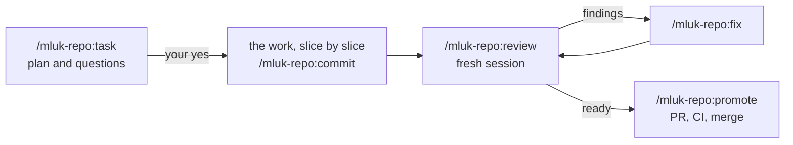
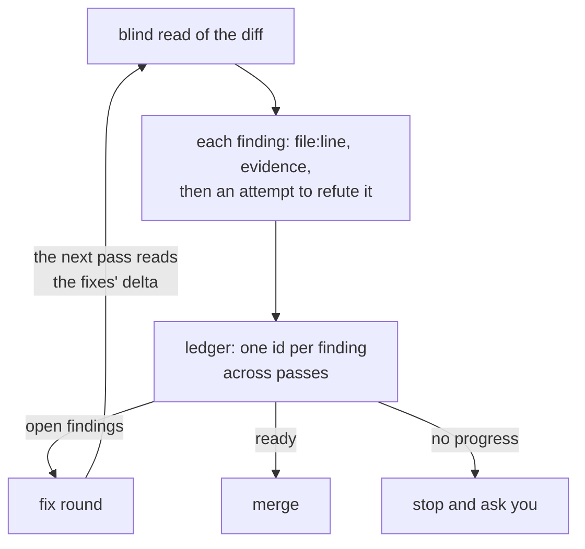

# agent-tools

Claude Code plugins that keep the agent on your project's sources and a fixed
procedure — and end every step with the next one, ready to paste.

- **The next prompt, ready.** Every workflow command ends with the next step
  as a block to copy, and says whether it belongs in a fresh session.
- **Sources, not memory.** The agent works from the code, the spec, the design
  and the docs; what they leave open becomes a question to you.
- **Reviews that prove their findings and know when to stop.** They check the
  UI against the design, not only the code itself; zero findings is a valid
  result.
- **Decisions stay yours.** What needs your attention is brought to you, not
  settled quietly; push, PR and merge wait for your yes.
- **Sessions sized to the change.** Each phase starts fresh from files, not
  from a long transcript; a small change runs whole in one.

For a developer on a GitHub project without an issue tracker. A team on a
tracker, or on GitLab, fits
[work-agent-tools](https://github.com/maximlukyanovich/work-agent-tools).

## How a task runs



Each arrow is a block the agent prints at the end of a command — for example,
after the last commit of a task:

```
/mluk-repo:review feat/password-reset
```

The block points at the plan, the branch and the review ledger instead of
retelling them, so the next session reads the sources again rather than a
summary of the last one. Your part comes down to choosing and approving the
next prompt; `/mluk-repo:next` says what to take when nothing is in progress.

A task starts by reading before it plans: the code, the project profile, the
spec and the design, the library's documentation instead of the model's memory
of it, and what the project already has that the task can reuse. What these do
not answer is asked, not assumed, and no code is written before you approve
the plan. A small change — by its size and risk — skips the extra sessions.

## Why the review is different



- **A serious finding is proved.** A `blocker` or `major` names the line and the
  scenario, and the reviewer tries to refute it in the code before reporting.
- **A finding keeps its id.** A recorded false positive is not raised
  again without a new mechanism; an incomplete fix stays the same finding, not a new one.
- **The design is a source, too.** UI in the diff is checked against the
  project's design source, not only against the code around it.
- **Repeat passes read what changed** — the fixes and what they removed —
  instead of the whole branch again.
- **It converges.** `minor` and `nit` get a decision, not another pass; a pass
  that makes no progress stops and asks.

The built-in `/code-review` of Claude Code 2.1.319 asks for a minimum number
of findings. A review here is a check, not a quota: zero findings is a valid
result.

## Measured

On live projects, against the built-in `/code-review` at `high` — 14 branches,
about 40 passes, 2026-11-08:

- **Full pass.** On one project's 8 branches the built-in review found no
  `major` that ours missed, and ours found 7 that it missed; on the other's 6,
  3 to 3.
- **False findings.** One in about 40 passes, dropped before the report;
  the built-in raised 9 on one project and one or two per pass on half of
  the other's.
- **Price.** A full pass costs about three built-in runs and finds about
  three times as many confirmed findings: per confirmed finding the two are
  about even.
- **Sessions.** On a solo project since 2026-10-01, 86 % of 149 sessions over
  36 merged tasks started with a command or a block the agent had printed.

Conditions, the repeat passes on fixes and the cost of a fix round in an old
session: [`docs/measured.md`](docs/measured.md).

## Does it fit your project

Each plugin is enabled on its own, so a project takes only what fits.

| Plugin | For | What it does |
| --- | --- | --- |
| [`mluk-bootstrap`](plugins/mluk-bootstrap/README.md) | any repository | Creates a project or sets up and audits its agent harness: `AGENTS.md`, the project profile, skills, hooks, docs. |
| [`mluk-repo`](plugins/mluk-repo/README.md) | GitHub, no tracker | The workflow above: `task`, `commit`, `review`, `fix`, `promote`, `handoff`, `next` and more. |
| [`mluk-ru`](plugins/mluk-ru/README.md) | Russian texts for people | Client-facing, legal and documentation copy, and `review` for a text. |
| [`mluk-ops`](plugins/mluk-ops/README.md) | an agent on a live server | `srv` over `ssh` with an audit log and a guard hook. |
| [`mluk-fe`](plugins/mluk-fe/README.md) | React / Next.js, Tailwind, next-intl | UI and component conventions; hooks check locales, translation keys and titles. |
| [`mluk-design`](plugins/mluk-design/README.md) | a site built against a design kit | How a kit is ported. |
| [`mluk-deploy`](plugins/mluk-deploy/README.md) | Vercel, or Docker Compose on a VPS | Deployment, and a domain moving to Cloudflare. |

The stack plugins mostly need no command: their skills load when the work
reaches them, and their hooks check what the agent writes.

## Quick start

You need Claude Code, `git`, and `gh` signed in; `python3` for the `mluk-repo`
scripts and `mluk-ops`, Node for the `mluk-fe` hooks.

Once per machine — it adds the source and loads nothing into sessions:

```bash
claude plugin marketplace add maximlukyanovich/agent-tools
```

In an existing repository:

```bash
claude plugin install mluk-bootstrap@mluk-agent-tools --scope project
claude "/mluk-bootstrap:setup"
```

`setup` looks at the code, asks only what it cannot answer, shows a plan and,
on your yes, writes the harness and enables the plugins the project needs;
`mluk-repo` comes with it. In an empty folder, `/mluk-bootstrap:new` creates
the project first:

```bash
mkdir my-app && cd my-app
claude plugin install mluk-bootstrap --marketplace maximlukyanovich/agent-tools --scope project && claude "/mluk-bootstrap:new"
```

Every plugin introduces itself, read-only: `/mluk-repo:help`,
`/mluk-bootstrap:help`, `/mluk-ru:help en`.

A project that `setup` wrote to follow `main` receives new versions by
itself; one pinned to a release moves when its `ref` does. Elsewhere, turn
that on once: `/plugin` → **Marketplaces** → `mluk-agent-tools` → **Enable
auto-update**. Scopes, updates, releases and pinning a project to one:
[`docs/updates.md`](docs/updates.md).

## How it's built

`mluk-bootstrap` generates: what `setup` writes becomes the project's own code.
The rest are libraries: the procedure stays here, and the project contributes a
profile, `.claude/project-profile.md`, that every command reads first —
[`docs/design.md`](docs/design.md).

Issues and pull requests are welcome — [`CONTRIBUTING.md`](CONTRIBUTING.md).
[MIT](LICENSE).
